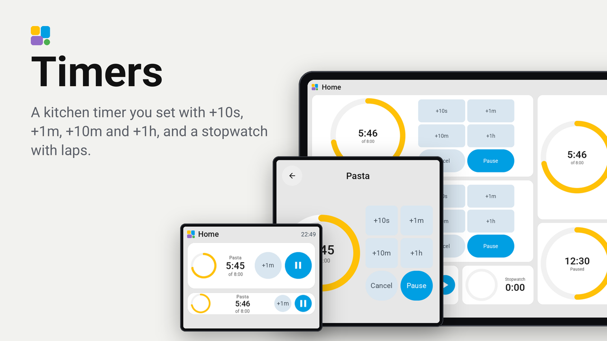
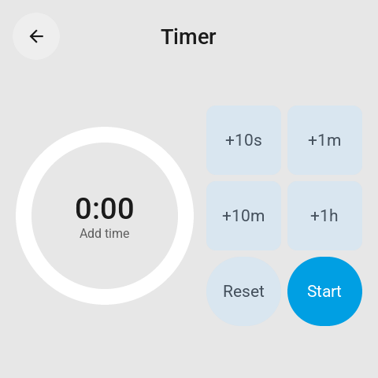
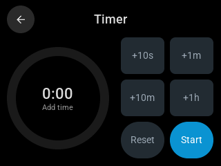

# Timers

A kitchen timer, a stopwatch, and Home Assistant Assist voice timer support on a Tessera screen. You set a kitchen timer with four keys that add time (**+10s**, **+1m**, **+10m** and **+1h**) and start it, or create multiple named timers by voice when **Voice assistant (`voice_assist`)** is installed on the same screen.

The kitchen timer runs on the screen itself, or as a `timer` helper of Home Assistant, so the same timer shows on your phone and in your automations. The stopwatch runs on the screen and keeps the last three laps. Both keep running through a restart of the screen. The **All timers** tile combines active screen, helper, and Assist voice timers into one live multi-timer view.

## Set up

1. In Tessera, open Plugins and choose **Timers**, or choose **Add with a link** and paste
   `https://github.com/Heronimonimo/tessera-timers`.
2. Tick the screen and apply. The screen builds once.
   - If the screen also runs **Voice assistant (`voice_assist`)**, Timers automatically enables Assist voice timers (`FEATURE_TIMERS`) and listens for started, updated, cancelled, and finished voice timers.
3. In Layout, place the **Timer**, **Stopwatch**, or **All timers** tile from the library's Plugins group.
4. Only for a timer you want in Home Assistant too: make a timer helper first (Settings, Devices & services, Helpers,
   Create helper, Timer), then choose it as the Timer tile's entity in the inspector. Leave the entity empty for a
   timer that runs on the screen alone.

## What it shows

- **Timer (`1×1` to `3×3`)**:
  - **1x1**: the ring and the time. A tap opens the full-screen card with every key.
  - **2x1**: the ring, the time, **+1m** and Start or Pause. A tap on the time opens the card.
  - **1x2**: the ring, **+1m** and **+10m**, and the two keys that act.
  - **2x2 and up, and the card**: the ring beside all four add keys, with Reset or Cancel and Start or Pause.
- **All timers (`1×1` to `4×3`, or full page)**:
  - Shows all active, paused, and finished timers (Assist voice timers, HA timer helpers, and screen timers) with live countdowns and progress bars, sorted by soonest to finish.
  - Tapping opens the **All timers** card, where you can pause/resume/cancel screen or helper timers, stop ringing timers, or tap **Ask Assist** to speak a voice timer command.
- **When a timer finishes**:
  - By default, a global popup (**Show popup when a timer is done**) wakes the screen over any page or screensaver, shows the finished timer name(s), and rings until you tap **Stop** (or for up to 60 seconds).
  - On a screen with a speaker, **Timer alarm volume** raises the speaker volume to at least the configured percentage while ringing (`0%` follows the screen's current volume).

The stopwatch: Start, Pause and Resume; **Lap** while it runs, **Reset** while it is paused. The tile shows the newest
lap, the larger tiles and the card the last three.



The card on the Guition 4-inch and the CYD, drawn by the real firmware on Tessera's preview bench:

 

Every tile at every size on the four screens of the bench: [renders/overview.png](renders/overview.png).

## In the top bar

In Layout, open a page's top bar and add **Running timer** or **Running stopwatch** from the plugins. They show only
while a timer or a stopwatch runs (including Assist voice timers), in whole minutes ("6 min", "1 h 05"): the top bar looks again every five seconds,
so the tile and the card keep the seconds. A timer that is done shows a red bell and Done. With several timers the bar
shows the one that ends first, with several stopwatches the one that runs longest.

## Settings

On a screen with a speaker (from its board, such as the reTerminal D1001, or from another plugin) the plugin's details
also have the part **Ring when a timer is done**, on by default, the **Timer sound** switch, and **Timer alarm volume** (0–100%, where 0% follows the screen's own volume and higher values raise the speaker volume while ringing).

On the screen's Plugins tab, the plugin's details, **Settings**:

- **Show popup when a timer is done**: wakes the screen and opens a dismissible popup over any page when any timer finishes (on by default).
- **Open the timer when it is done**: if the popup is turned off, a timer on the screen opens its card when the time is up (on by default).

Home Assistant also gets a **Timer done** binary sensor of the screen: on while a timer of the screen is done. Use it
to send a notification to your phone.

With several timer helpers on one screen, the **Timers done** sensor says which ones are done: their entity ids, such
as `timer.eggs, timer.rice`, or nothing. A helper leaves the list when Stop, +1m or Cancel is tapped on its tile, or
after half an hour. An automation that plays an alarm for `timer.eggs` can stop it when the helper is no longer in the
list:

```yaml
triggers:
  - trigger: state
    entity_id: sensor.kitchen_screen_timers_done
conditions:
  - condition: template
    value_template: "{{ 'timer.eggs' not in trigger.to_state.state.split(', ') }}"
actions:
  - action: script.turn_off
    target:
      entity_id: script.eggs_alarm
```

Timers that run on the screen itself or via Assist voice commands have no helper entity id, so only the binary sensor counts them.

The **Silence timers** button of the screen does what Stop does on every timer of the screen that is done: the ringing
stops and the timer goes back to idle, while running timers run on. Press it from an automation that stopped its own
alarm another way, such as a button on a phone's notification, so the screen stops too.

## Good to know

- A timer on the screen and the stopwatch belong to their tile's place in the layout: moving a tile to another place
  starts it fresh.
- A timer helper is run by Home Assistant. Adding time to it while it runs starts it again with the new time, so its
  ring starts full again. Home Assistant's own `timer.finished` event fires as always.
- Assist voice timers are managed server-side by Home Assistant's Assist pipeline; ESPHome's `voice_assistant` protocol does not expose device-to-HA pause/cancel RPCs, so use voice commands (or tap **Ask Assist** in the **All timers** card) to pause or cancel a voice timer.
- The screen counts on its own clock, which Home Assistant sets: until it is set (right after a start) a timer on the
  screen waits.
- Tried on a real screen, the M5Stack Tab5, and on the preview bench on the CYD, the Guition 4-inch, the Waveshare
  4.3-inch standing up and the Guition 10.1-inch, light and dark.
