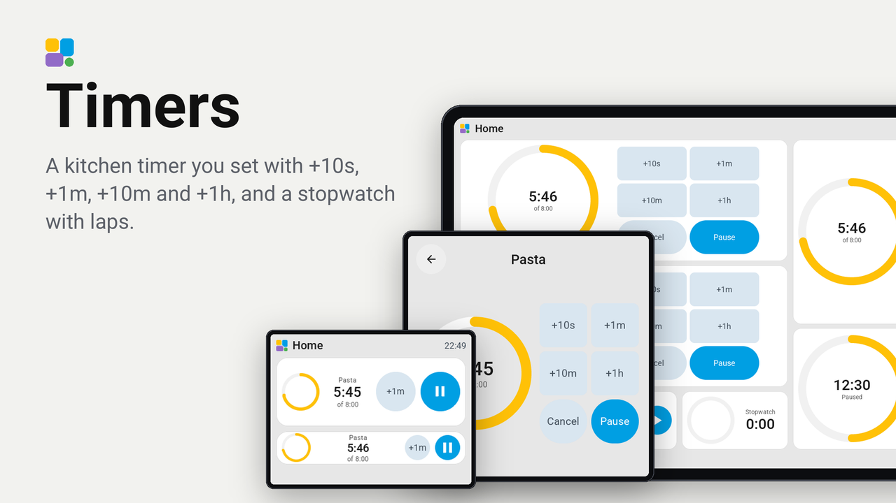
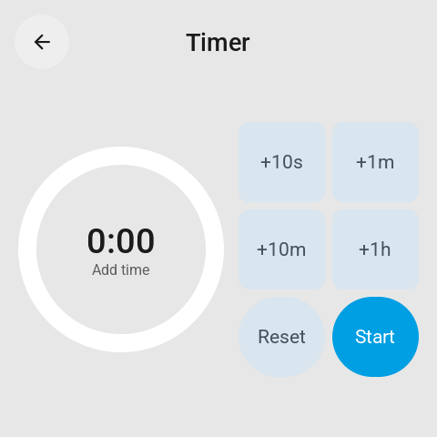
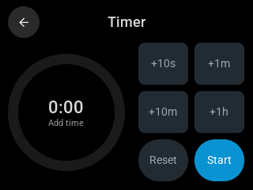

# Timers

A kitchen timer and a stopwatch on a Tessera screen. You set the timer with four keys that add time, **+10s**, **+1m**,
**+10m** and **+1h**, and start it: no dial to turn, no numbers to type. A ring shows how much is left, and when the time
is up its ring and time turn red and it says Done.

The timer runs on the screen itself, or as a timer helper of Home Assistant, so the same timer shows on your phone and
in your automations. The stopwatch runs on the screen and keeps the last three laps. Both keep running through a
restart of the screen.

## Set up

1. In Tessera, open Plugins and choose **Timers**, or choose **Add with a link** and paste
   `https://github.com/Heronimonimo/tessera-timers`.
2. Tick the screen in the kitchen and apply. The screen builds once.
3. In Layout, place the **Timer** or the **Stopwatch** tile from the library's Plugins group, at any size from 1x1 to
   3x3.
4. Only for a timer you want in Home Assistant too: make a timer helper first (Settings, Devices & services, Helpers,
   Create helper, Timer), then choose it as the Timer tile's entity in the inspector. Leave the entity empty for a
   timer that runs on the screen alone.

## What it shows

- **1x1**: the ring and the time. A tap opens the full-screen card with every key.
- **2x1**: the ring, the time, **+1m** and Start or Pause. A tap on the time opens the card.
- **1x2**: the ring, **+1m** and **+10m**, and the two keys that act.
- **2x2 and up, and the card**: the ring beside all four add keys, with Reset or Cancel and Start or Pause.

The timer:

- **Setting it**: tap the add keys until the time is right (2 x +1m and 3 x +10s is 2:30), then Start. Reset sets it
  back to 0:00.
- **While it runs**: the add keys add time to it; Pause and Resume, or Cancel.
- **When it is done**: its ring and time turn red and it says Done. On a screen with a speaker it rings too: three
  beeps every two seconds for a minute, or until you tap Stop. **+1m** gives it another minute, Stop ends it. A timer on the
  screen opens its card when it is done, on whatever page shows; turn that off with the setting below.

The stopwatch: Start, Pause and Resume; **Lap** while it runs, **Reset** while it is paused. The tile shows the newest
lap, the larger tiles and the card the last three.

The card on the Guition 4-inch and the CYD, drawn by the real firmware on Tessera's preview bench:

 

Every tile at every size on the four screens of the bench: [renders/overview.png](renders/overview.png).

## In the top bar

In Layout, open a page's top bar and add **Running timer** or **Running stopwatch** from the plugins. They show only
while a timer or a stopwatch runs, in whole minutes ("6 min", "1 h 05"): the top bar looks again every five seconds,
so the tile and the card keep the seconds. A timer that is done shows a red bell and Done. With several timers the bar
shows the one that ends first, with several stopwatches the one that runs longest.

## Settings

On a screen with a speaker (from its board, such as the reTerminal D1001, or from another plugin) the plugin's details
also have the part **Ring when a timer is done**, on by default, and the setting **Timer sound**: a switch that turns
the beeps off and on again without a build, also on the screen's settings page and in Home Assistant. The beeps follow
the screen's volume.

On the screen's Plugins tab, the plugin's details, **Settings**:

- **Open the timer when it is done**: a timer on the screen opens its card when the time is up (on by default).

Home Assistant also gets a **Timer done** binary sensor of the screen: on while a timer of the screen is done. Use it
to send a notification to your phone.

## Good to know

- A timer on the screen and the stopwatch belong to their tile's place in the layout: moving a tile to another place
  starts it fresh.
- A timer helper is run by Home Assistant. Adding time to it while it runs starts it again with the new time, so its
  ring starts full again. Home Assistant's own `timer.finished` event fires as always.
- The screen counts on its own clock, which Home Assistant sets: until it is set (right after a start) a timer on the
  screen waits.
- Tried on a real screen, the M5Stack Tab5, and on the preview bench on the CYD, the Guition 4-inch, the Waveshare
  4.3-inch standing up and the Guition 10.1-inch, light and dark.
